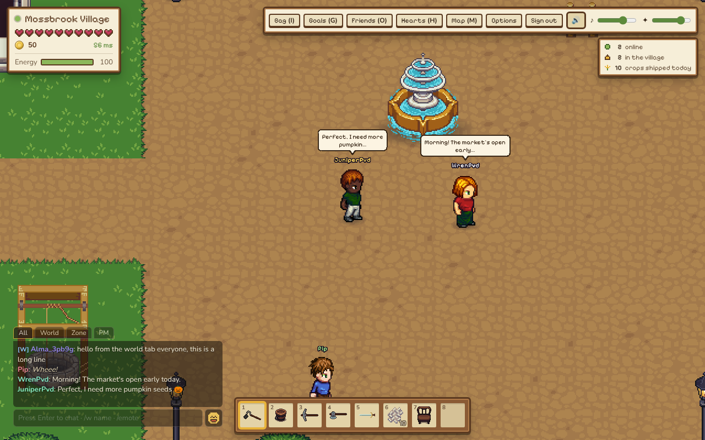
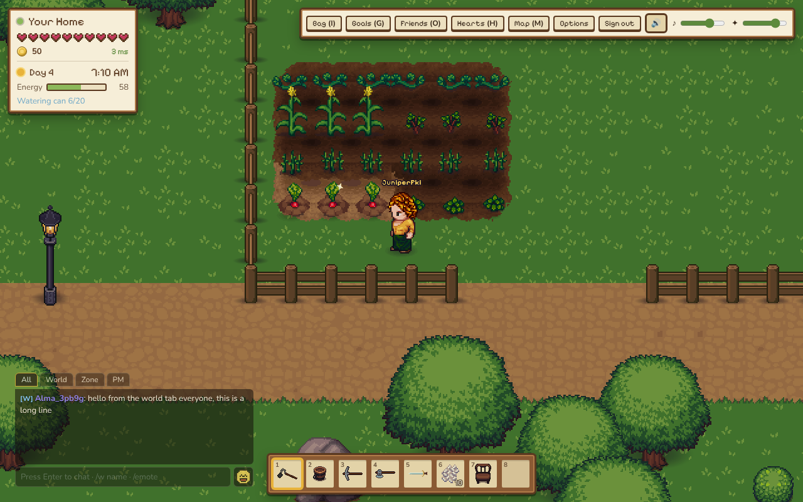
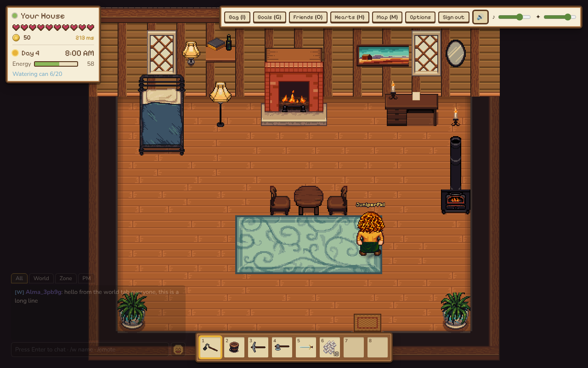
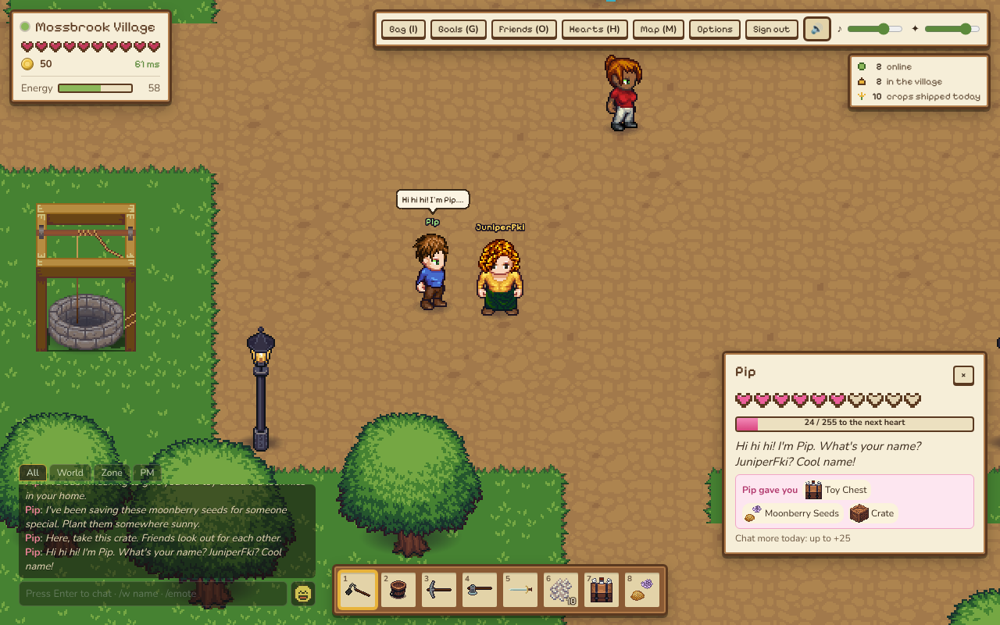
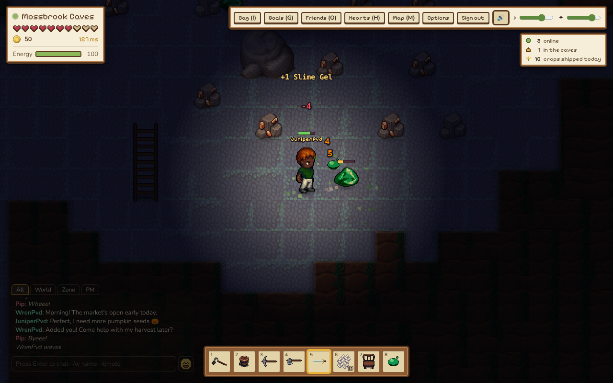
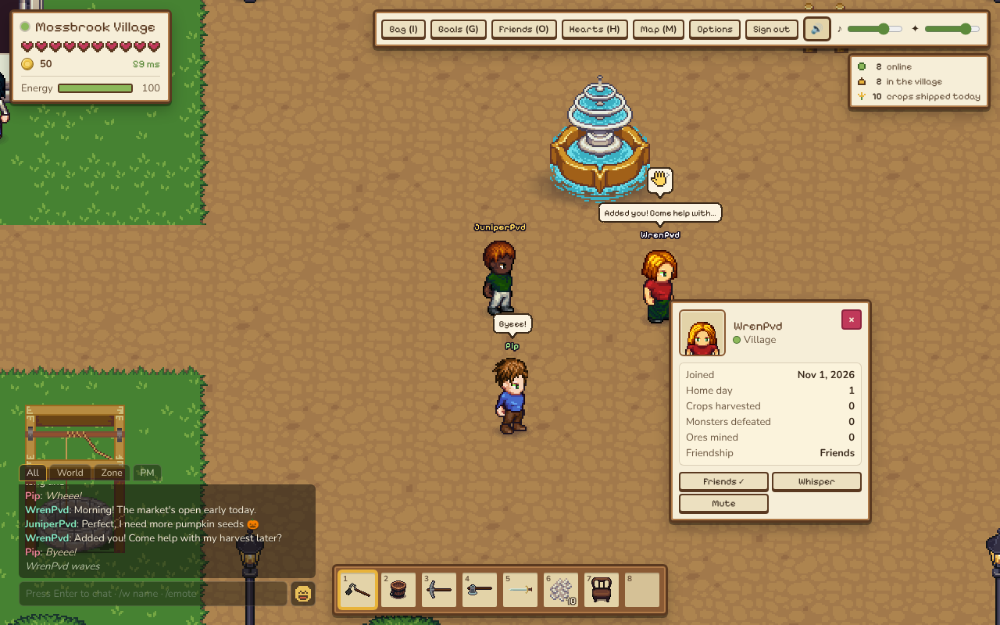

# DurableMMO

A cozy multiplayer farming game set in the valley of Mossbrook, with light monster hunting and mining. The server runs on Cloudflare Workers and Durable Objects, the client is PixiJS v8 (WebGPU with a WebGL fallback), and the art is from the Liberated Pixel Cup (LPC).

## Screenshots

| | |
|---|---|
|  |  |
|  |  |
|  |  |

## Features

- Your own home farm: till, plant, water and harvest over 20 crops that grow in real time (skip a day of watering and they wilt; three dry days and they die). Common seeds come from the market, rarer ones from monsters, and the rarest from villager friends. Decorate with furniture and fences (inside the house, the Edit button or T lets you drag, turn, box-select and place several pieces at once, on a phone too): the village Furniture Stall sells cosy and modern pieces (a fridge that keeps your food among them). Rare pieces only drop from cave monsters or come as gifts from close villager friends
- Every house has a bed and a wardrobe. Open the wardrobe (F, or click it) to change your body, skin, hair and clothes; everyone sees the new look. You can move both, but never pick them up, and visitors can't use yours
- Silver and gold crops: your farming level grows with every harvest and raises the odds, some crops give extras, and each harvest is rolled from a fixed seed (owner, day, tile) so retrying can't reroll it. Rules live in `src/shared/engine/harvest.ts`
- Tools land mid-swing: the soil, chips or splash show at the tool's impact frame for you and for anyone watching (timings in `src/shared/engine/toolTiming.ts`)
- Shared zones (village, riverside, the quarry and its caves) with other players, chat, shops and village goals everyone contributes to
- The village notice board (in the square and in the town hall; one board for both and for every village copy): pin a short notice for 200 coins, like or dislike others' notices. Rules and limits live in `src/shared/notices.ts`
- Mining in the caves: stone, copper, iron, silver, gold, gem crystal and diamond rocks. Gold and diamond rocks are very rare (about 3% and 0.6% of cave rocks), sit mostly on the deepest floor, need the iron pickaxe and take 6 and 8 hits. Ship any stone, ore, gem, forage, fish or material in your shipping bin at its full value, or sell ore to the smith on the spot for 60% of it. Ore tiers live in `src/shared/engine/rockOres.ts`
- Mining, tree chopping and light combat against slimes, bats and rock crabs: rocks and trees take several hits, trees fall to stumps and regrow, and every tool can hit monsters (swords hit hardest). Tool rules live in `src/shared/engine/toolRules.ts`
- Ten villagers who chat and react. Their decisions come from rules, optionally TypeSafe Jev, with lines from Workers AI
- Click a villager (or press F next to one) to open the conversation window and type replies. Each reply is judged good, neutral or bad for that villager (TypeSafe Jev when available, word lists otherwise) and moves your hearts with them: a liked reply adds a little (at most once every 20 s, capped per day), a rude one takes some away (also capped per day). The rules live in `src/shared/npcChat.ts`
- Character creator, guest play with an upgrade to a full account later, music and sound effects

## How it runs on Cloudflare

The whole game is one Worker plus a few Durable Objects. There is no separate game server, database server or CDN to run.

| Service | What the game uses it for |
|---|---|
| **Workers** | The single entry point (`src/worker/index.ts`): sign-up and sign-in at `/api/auth/*`, the player API, uploads, WebSocket upgrades at `/ws/:zone`, and the built client as static assets. It checks the session and passes identity to the Durable Objects in `x-dmmo-*` headers, stripping any copies the browser sent. |
| **Durable Objects: `ZoneRoom`** | One per shared map (village, riverside, quarry, each cave floor and interior). It runs the authoritative 10 Hz tick: players, villagers, monsters, rocks, trees, chests, shops, ground items and village goals. When a map is full it opens a copy (see Limitations). |
| **Durable Objects: `HomeRoom`** | One per player (`idFromName(userId)`), acting as that player's character record: inventory, coins, stamina, water, hearts, pets, barn and hens, farm tiles, furniture, the fridge, mail and their private home map. Zones load and save players through its RPC methods, and only its owner may change it. |
| **Durable Objects: `SocialRoom`** | One global room for world chat, whispers, presence, the online counts and the village notice board. |
| **Durable Objects: `NpcAgent` and `AiBudget`** | `NpcAgent` is one agent per villager and player, holding that villager's memory of you. `AiBudget` is one global counter that caps the day's AI spend. |
| **Durable Object storage (SQLite)** | Each object keeps its own state in its built-in storage: the save in `HomeRoom`, rocks, trees, chests, ground items and goals in `ZoneRoom`. Zones write player saves back every 5 seconds and when a player leaves. |
| **WebSocket Hibernation** | Every room accepts sockets with `ctx.acceptWebSocket` and keeps per-socket data in attachments. The tick only runs while someone is connected, so an empty map sleeps and costs nothing. |
| **Alarms** | `HomeRoom` sets an alarm to regrow broken rocks and trees in the yard and to end the day on time. Crops still grow from timestamps, not timers. |
| **D1** | Better Auth tables, plus friends, unique names and mutes (`migrations/`). Game state never goes here. |
| **R2** | Art and player uploads, served by the Worker at `/files/*`. |
| **Workers AI** | Villagers' spoken lines. The cheaper model (`NPC_MODEL`) writes lines, and a function-calling model (`NPC_AGENT_MODEL`) runs the per-player agents. Without it, villagers use scripted lines. |
| **Turnstile** | Captcha on sign-up and sign-in. |
| **Cron Triggers** | A daily job (`src/worker/cron.ts`) deletes guest accounts idle for over 30 days, with their home, uploads and villager memories. |
| **Observability** | Worker logs are on (`"observability"` in `wrangler.jsonc`). |

TypeSafe Jev (`@typesafe-ai/sdk`) is the one outside service: it makes fast typed villager decisions and judges replies in the conversation window. Without its key, rules and word lists do the same job.

### How the load is kept down

- **Updates go to nearby players first.** Each player gets every tick for things within 24 tiles. Things farther away are batched to 2 updates a second (`src/worker/game/interest.ts`).
- **Slow work never holds up the tick.** AI and RPC calls run in the background, and their results apply when they arrive.
- **Loot is only sent to its owners.** Loot on the ground goes only to the players it belongs to.

### Limitations

**Limits this game sets**

| Limit | Value | Why |
|---|---|---|
| Players per map copy | 60 (`ZONE_CAP`) | One object runs the whole map's tick on a single thread. Past 60, the next player joins a copy ("Mossbrook Village · 2"), and players in different copies don't see each other. |
| Copies per map | 8 (`MAX_COPIES`) | So 480 players per map at most. Further joins get "full". |
| AI spend per day | `AI_DAILY_NEURONS` (9,000 by default) | When it runs out, villagers fall back to scripted lines until the next UTC day. |

**Limits set by the platform**

- **Storage per object:** up to 10 GB, so one player's save has plenty of room.
- **Value or row size:** at most 2 MB. Saves are split into separate keys (inventory, farm, objects, mail, containers) to stay far below it.
- **WebSocket message size:** at most 32 MiB. Game messages are a few KB.
- **Per-socket attachment:** at most 16 KB. Only identity and a few small fields go there.
- **Requests per object:** about 1,000 a second (a soft limit). This is one more reason maps split into copies instead of growing.
- **One location per object:** an object lives in one Cloudflare location, picked near whoever first used it, so players far from a map's room see more ping.
- **Workers AI isn't available offline:** `npm run dev:local` has no AI binding, so villagers use scripted lines and word lists.
- **D1 holds accounts only:** game state lives in Durable Objects, so a player's whole game can't be queried with SQL across all players.

## Requirements

- Node.js 22 or newer, and npm
- A Cloudflare account only to deploy or to use Workers AI locally. `npm run dev:local` works offline without one.

## Run locally

1. Install dependencies:

   ```sh
   npm install
   ```

2. Create `.dev.vars` from the example and set a secret of at least 32 characters:

   ```sh
   cp .dev.vars.example .dev.vars
   openssl rand -base64 32   # paste the output after BETTER_AUTH_SECRET=
   ```

   Leave `TURNSTILE_*` empty. `TYPESAFE_API_KEY` is optional.

3. Create the auth tables in the local D1 database (stored under `.wrangler/`):

   ```sh
   npm run db:migrate:local
   ```

   This runs `wrangler d1 migrations apply durable-mmo-auth --local --env local`.

4. Build the client and start the Worker:

   ```sh
   npm run dev:local
   ```

5. Open http://localhost:8787, type a farmer name and press **Play as guest**. Guests can play on their own farm. Create an account (any email works locally) to visit the shared zones.

### How local differs from production

`npm run dev:local` runs `wrangler dev --env local`, which:

- turns the Turnstile captcha off (empty keys and `DMMO_ENV=local`)
- has no Workers AI binding, so NPCs use scripted lines (`NPC_AI_MODE=off`) and replies in the conversation window are judged by word lists instead of Jev. They still remember you: each NPC keeps a private memory per player (your name, gifts, things you told it). Outside your home, press Q next to a villager to give them the selected hotbar item (at home Q eats).
- turns on dev tools (`DEV_TOOLS=on`): at home, `/day` ends the day (like sleeping) and `/time 21` sets the clock

`npm run dev` uses the default environment with the real Workers AI binding. It needs `npx wrangler login`, plus `CAPTCHA_DISABLED=1` in `.dev.vars` unless you set up Turnstile keys.

If you use another port, pass the matching auth origin, for example:

```sh
npx wrangler dev --env local --port 8796 --var BETTER_AUTH_URL:http://localhost:8796
```

## Tests

```sh
npm run typecheck   # tsc for the combined, worker and client configs
npm test            # Vitest unit tests in test/
npm run e2e         # Playwright browser run against a running dev server
```

`npm run e2e` expects the Worker from `npm run dev:local` to be running. It reads `BASE_URL` (default `http://localhost:8787`), writes screenshots to `SHOTS_DIR` (default `test-results/e2e`), and uses an installed `playwright` package or the Chromium at `CHROMIUM_PATH`:

```sh
BASE_URL=http://localhost:8796 npm run e2e
```

`npm run e2e:playtest` plays every feature with two accounts and a guest (chat, PMs, emotes, friends, NPC memory, interiors and seats, monsters, farming, night and sleep, home visits) and saves numbered screenshots to `SHOTS_DIR` (default `test-results/playtest`) for a visual check. It clears the local D1 sign-up rate limit first, so run it only against `npm run dev:local`.

## Deploy to Cloudflare

```sh
npx wrangler login
npx wrangler d1 create durable-mmo-auth          # copy the database_id into wrangler.jsonc (both d1_databases entries)
npx wrangler r2 bucket create durable-mmo-files
npx wrangler secret put BETTER_AUTH_SECRET        # 32+ random characters
npx wrangler secret put BETTER_AUTH_URL           # your public origin, e.g. https://durable-mmo.example.workers.dev
npx wrangler secret put TURNSTILE_SECRET_KEY      # from the Turnstile dashboard
npm run db:migrate:remote
npm run deploy                                    # vite build, then wrangler deploy
```

Set `TURNSTILE_SITE_KEY` in `wrangler.jsonc` → `vars` before deploying. `BETTER_AUTH_URL` can be a var instead of a secret.

Optional services:

- **Workers AI** is on by default in production (`NPC_AI_MODE=on`, model in `NPC_MODEL`). `AI_DAILY_NEURONS` caps daily spend. When the budget runs out NPCs fall back to scripted lines.
- **TypeSafe Jev** for typed NPC decisions: `npx wrangler secret put TYPESAFE_API_KEY`. Without it NPCs use rule-based decisions.
- **Turnstile** captcha on sign-up and sign-in: the site key and secret above. Without a secret, production sign-up and sign-in answer 503. Set `CAPTCHA_DISABLED=1` to run without a captcha on purpose.

### Drop rates

Every random drop in the game goes through one helper (`src/shared/engine/dropRate.ts`), so you can turn drops up or down with Worker vars. Defaults are in `wrangler.jsonc` → `vars`; locally you can also set them in `.dev.vars` or with `--var DROP_RATE:2`.

| Var | Scales | Default |
|---|---|---|
| `DROP_RATE` | every chance drop below, unless its own var is set | `1` |
| `DROP_RATE_MONSTER` | monster loot and seeds dropped by monsters | unset (uses `DROP_RATE`) |
| `DROP_RATE_ROCK` | bonus rock drops and silver rocks in the caves | unset |
| `DROP_RATE_CHEST` | the cave chests' second roll and bonus finds | unset |
| `DROP_RATE_FORAGE` | how much forage a zone grows | unset |
| `DROP_RATE_GIFT` | villagers' heart-milestone gifts | unset |
| `DROP_RATE_HARVEST` | extra crops from a harvest | unset |
| `DROP_RATE_RARE` | rare items wherever they drop: gems, diamond and gold rocks, gold ore, rare seeds, furniture. Wins over the category var | unset |

Each value is a multiplier on the chance (`2` doubles it, `0.5` halves it, `0` turns those drops off). Values are clamped to 0..10, empty or non-numeric values are ignored, and an effective chance never goes above 100%. Guaranteed drops (the ore a rock always gives, wood from trees, a villager's gift at full hearts) are never scaled. Each Durable Object reads the vars once when it starts.

The Worker does not serve `/api` or `/ws` while `BETTER_AUTH_SECRET` is missing, shorter than 32 characters, or a placeholder. WebSocket upgrades are accepted only from the `BETTER_AUTH_URL` origin. A daily cron deletes guest accounts idle for more than 30 days.

## Project layout

```
src/
  worker/     Worker entry, Better Auth, HTTP routes, ZoneRoom / HomeRoom / AiBudget Durable Objects
    game/     server game logic (sessions, shops, goals, monsters, rate limits)
    npc/      NPC catalog, rules, Jev and Workers AI glue
    social/   SocialRoom Durable Object: world chat, whispers, presence, server stats
    friends/  friend requests and the /api/friends routes
  shared/     code used by server and client: protocol, types, items, engine/, maps/
  client/     PixiJS client
    game/ render/ net/ state/ art/ audio/ ui/
    public/assets/   art, audio and their CREDITS files
migrations/   D1 migrations (Better Auth tables, friends, unique names, mutes)
test/         Vitest tests
scripts/      e2e.mjs (Playwright)
```

## Chat and names

- Chat channels: **Zone** (everyone in your zone, speech bubbles), **World** (everyone online, `/world` or the World tab) and **whispers** (`/w name message`, `/r message` to reply, or click a name in the chat log or a player). Bubbles show the first 5 words; the log has the full line. `/emote wave` (or the picker next to the input) shows an emote above your head to the zone.
- World chat and whispers go over a second WebSocket, `/ws/social`, to one global `SocialRoom`. Guests can read world chat but not send world chat or whispers.
- Right-click (or long-press) a player, or a name in chat, for their **player card**: portrait, online and zone, join day, home day, crops harvested, monsters defeated, ores mined and friendship, with Add friend, Whisper, Invite home and Mute. It reads `GET /api/players/:id/card` (signed in, rate-limited, public info only; guests get a minimal card).
- **Mute** (`/mute name`, `/unmute name`, the card, or the Friends panel's Muted tab) is a per-account list in D1 (`migrations/0007_mutes.sql`, `/api/mutes`). It is one-way and silent. The server drops whispers, home invites and friend requests from muted players; the client hides their zone chat, bubbles, world chat and emotes.
- **Notice board**: press F next to the board in the village square or the town hall, or click it. A notice is at most 160 characters of plain text (control and invisible format characters stripped) and costs 200 coins, taken by the zone before the post and refunded if the board refuses it. One new notice per player every 5 minutes; the board keeps the newest 50, and each comes down after 7 days. One vote per player per notice (the same button again takes it back; no votes on your own); authors can take their notice down (no refund). Notices from players you muted are hidden from you. The board is stored in the global `SocialRoom` (one storage key per notice), so every village copy and the town hall show the same board, and votes and new notices reach everyone looking at it live over `/ws/social`. Players who are muted for spamming chat can't pin notices.
- Names are 3-16 letters, numbers or `_`, unique ignoring case (`migrations/0006_unique_names.sql`); the forms check `GET /api/name-check` before submitting. Guests start as `Guest_xxxxxx` and then take the name they typed if it is free. An account may claim a name a guest holds; that guest goes back to a `Guest_xxxxxx` name. Names from before this rule are shown with other characters replaced by `_`.

## Credits

DurableMMO stands on the work of many generous artists, musicians and open-source projects. Thank you all. See **[CREDITS.md](CREDITS.md)** for the music, sound effects, art and libraries the game uses, with links to the per-file credits for every asset. The in-game **Credits** button, on the start screen and in the HUD menu, lists them too.

## License

The code is open source under the [MIT License](LICENSE), copyright (c) 2026 Elson Tan.

The art, music and sound effects in `src/client/public/assets/` are **not** covered by the MIT License. Each keeps its own license (CC0, CC-BY, CC-BY-SA, OGA-BY or GPL), as listed in [CREDITS.md](CREDITS.md) and the per-file CREDITS files. If you reuse them, follow those licenses, including attribution and share-alike where required.
